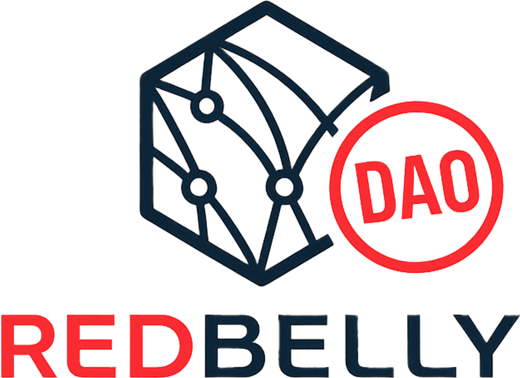
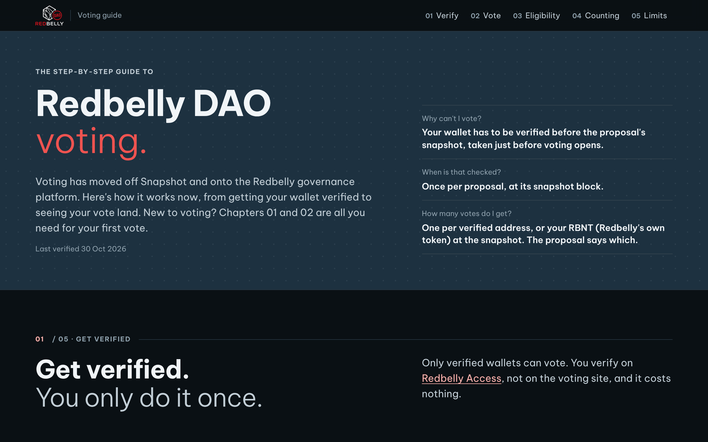
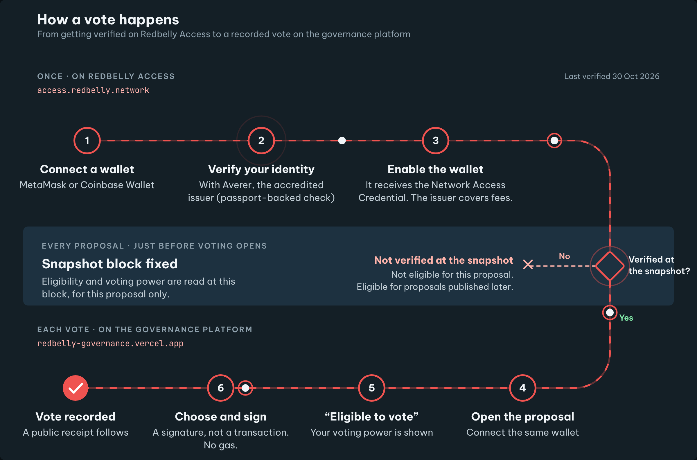
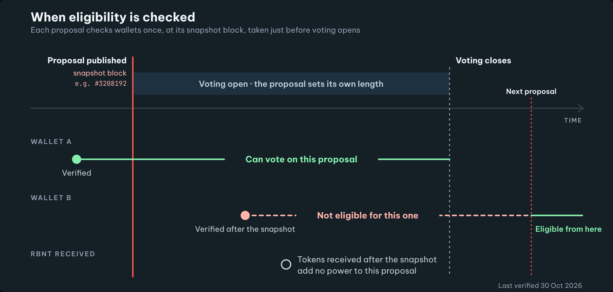

<div align="center">

<picture>
  <source media="(prefers-color-scheme: dark)" srcset="assets/logo-dark-bg.png">
  
</picture>

# Redbelly DAO Voting Guide

**The step-by-step guide to voting on the Redbelly DAO governance platform,**<br>
from getting your wallet verified to seeing your vote land.

[](https://redbelly-dao-voting-guide.vercel.app/)
[](VERIFICATION.md)
[](#run-it-locally)

[**Open the guide**](https://redbelly-dao-voting-guide.vercel.app/) · [Fact check](VERIFICATION.md) · [Diagrams](#diagrams) · [Rebuilding](#rebuilding)

</div>

<br>

<a href="https://redbelly-dao-voting-guide.vercel.app/">
  <picture>
    <source media="(prefers-color-scheme: light)" srcset=".github/preview-light.png">
    
  </picture>
</a>

## Why this guide

Redbelly DAO voting has moved off Snapshot and onto the [Redbelly governance platform](https://redbelly-governance.vercel.app/). Only identity-verified wallets can vote, and each proposal judges every wallet once, at its **snapshot block**. That one rule is why a wallet can be verified today and still be refused on a live vote. The guide explains the whole path in plain language, and every rule in it is checked against the live platform and the chain.

| Question | Short answer |
|---|---|
| **Why can't I vote?** | Your wallet has to be verified before the proposal's snapshot, taken just before voting opens. |
| **When is that checked?** | Once per proposal, at its snapshot block. |
| **How many votes do I get?** | One per verified address, or your RBNT (Redbelly's own token) at the snapshot. The proposal says which. |

## What's inside

| | Chapter | What it covers |
|---|---|---|
| **01** | **Get verified** | Redbelly Access, the passport check by Averer, the Network Access Credential (the "Receptor credential"), linking extra wallets |
| **02** | **Cast a vote** | Connect, check eligibility, pick an option, sign with no gas, find your vote and its IPFS receipt. Includes what a real vote never asks you to sign. |
| **03** | **The snapshot rule** | What a snapshot block is, why late verification doesn't count, and what each voting panel message means |
| **04** | **How many votes?** | One verified address one vote vs RBNT balance, the voting systems, more than one wallet, quorum and identity quorum |
| **05** | **Known limits** | Six limits of the current setup, each stated plainly and sourced |

New to voting? Chapters 01 and 02 are all you need for a first vote.

### On the page

- **Practice panel.** A copy of the real voting panel, using a past proposal, that walks through connect, choose, review and sign. It never touches a wallet and sends nothing.
- **Snapshot picker.** Select the block a wallet was verified at and see whether it could vote on the example proposal.
- **Animated diagrams** with a Pause / Play control, and portrait versions on screens up to 900px wide.
- **Light and dark themes** that follow the system setting, with animation switched off for anyone who prefers reduced motion.
- **One static file.** Plain HTML, CSS and a little vanilla JavaScript. No framework and no trackers. The only outside request is Google Fonts.

## Diagrams

<table>
  <tr>
    <td width="50%" valign="top">
      
      <p><b>Fig 1 · The whole path.</b> Steps 1 to 3 happen once. Everything from step 4 happens on every proposal.</p>
    </td>
    <td width="50%" valign="top">
      
      <p><b>Fig 2 · When eligibility is checked.</b> Wallet B verified too late for this proposal, but in time for the next one.</p>
    </td>
  </tr>
</table>

| Figure | Wide | Phone | Editable source |
|---|---|---|---|
| Fig 1 · Verification to vote | [PNG](diagrams/1-verification-to-vote.png) · [SVG](diagrams/1-verification-to-vote.svg) | [PNG](diagrams/1-verification-to-vote-mobile.png) · [SVG](diagrams/1-verification-to-vote-mobile.svg) | [wide](diagrams/source/1-verification-to-vote.svg) · [phone](diagrams/source/1-verification-to-vote-mobile.svg) |
| Fig 2 · Eligibility and the snapshot | [PNG](diagrams/2-eligibility-snapshot.png) · [SVG](diagrams/2-eligibility-snapshot.svg) | [PNG](diagrams/2-eligibility-snapshot-mobile.png) · [SVG](diagrams/2-eligibility-snapshot-mobile.svg) | [wide](diagrams/source/2-eligibility-snapshot.svg) · [phone](diagrams/source/2-eligibility-snapshot-mobile.svg) |

The SVGs are animated and play when opened in a browser. The PNGs are still frames. The source SVGs are plain SVG that opens in Figma, Inkscape, Illustrator or a text editor, and editors that ignore animation still show the complete diagram.

## Fact-checked

Every rule in the guide was checked on **30 October 2026** against four sources:

- the voting platform, [redbelly-governance.vercel.app](https://redbelly-governance.vercel.app/), including its public API
- [Redbelly Access](https://access.redbelly.network/), the verification flow and its FAQ
- the [Redbelly docs](https://vine.redbelly.network/identity/user-access/)
- the Redbelly chain itself, through the public RPC (chain ID 151)

Every interface message the guide quotes was found word for word on the live platform. The snapshot chapter rests on a live test: a wallet verified two minutes after voting opened is verified today and is still refused on that proposal.

[`VERIFICATION.md`](VERIFICATION.md) maps each rule to its source and gives the commands to check it again, for example:

```bash
curl "https://redbelly-governance.vercel.app/api/power?proposal=<proposal id>&voter=<wallet>"
```

## Project structure

```text
.
├── index.html            the guide, built and ready to host
├── VERIFICATION.md       every rule, its source, and how to recheck it
├── assets/               Redbelly DAO logos and favicons from the brand kit
├── diagrams/             Fig 1 and Fig 2 as PNG and animated SVG, wide and phone
│   └── source/           editable SVG sources
└── src/
    ├── index.src.html    page source
    ├── make_diagrams.py  writes the diagram SVGs
    └── build.py          places the diagrams into the page and writes index.html
```

## Run it locally

Open `index.html` in a browser. It needs `assets/` and `diagrams/` next to it. To serve it the way a host would:

```bash
python3 -m http.server 8000
```

Then visit http://localhost:8000.

## Rebuilding

The build uses only the Python 3 standard library.

```bash
python3 src/make_diagrams.py
```

```bash
python3 src/build.py
```

`make_diagrams.py` writes the four SVGs in `diagrams/source/`, so positions, text and timing can be changed there. `build.py` inlines them into `src/index.src.html` and writes `index.html`. While inlining, it swaps each diagram's hex colours for the page's theme tokens so the diagrams follow light and dark mode. After changing a diagram, copy the new SVG into `diagrams/` and export a fresh PNG so the download links match.

## Deploying

There is no build step for hosting. Publish the repository root as it is to any static host, such as Vercel, Netlify or GitHub Pages. The live guide runs on Vercel at [redbelly-dao-voting-guide.vercel.app](https://redbelly-dao-voting-guide.vercel.app/).

## Credits

- Logos and favicon from the Redbelly DAO brand kit.
- Type: [Be Vietnam Pro](https://fonts.google.com/specimen/Be+Vietnam+Pro), with [JetBrains Mono](https://fonts.google.com/specimen/JetBrains+Mono) for machine values.

The guide describes the platform as it was on 30 October 2026. It explains the rules as they are and doesn't suggest changing them.
